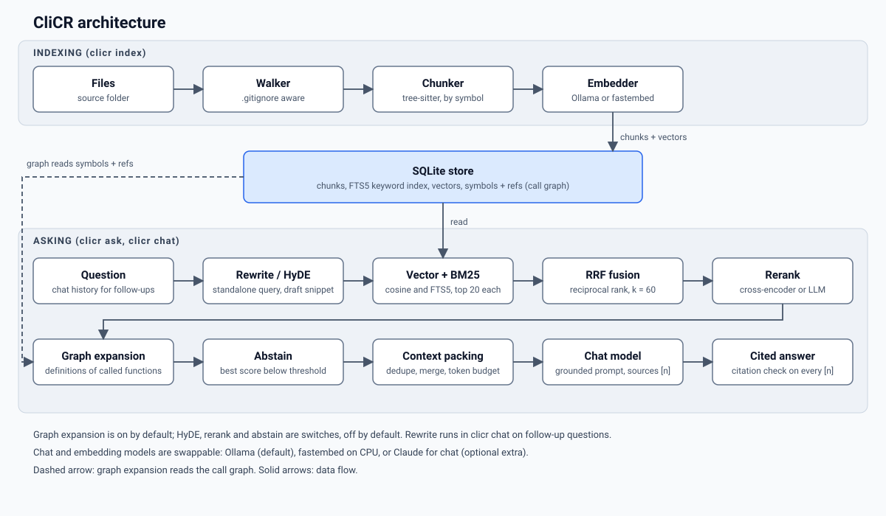

# CliCR

Ask questions about a codebase from the terminal. CliCR indexes a folder on your machine, finds the code that matters, and answers with citations to file and line.

[](https://github.com/jagdteam/clicr/actions/workflows/ci.yml)

<!-- media:demo -->

<!-- link:web-demo -->

## What it does

- **Runs locally by default.** Chat and embeddings go through [Ollama](https://ollama.com), so your code stays on your machine. Claude is an optional chat provider.
- **Splits code by structure.** tree-sitter cuts each file into functions and classes, and each chunk keeps its file, line range and enclosing symbol.
- **Searches two ways.** Vector search finds code by meaning, BM25 keyword search (SQLite FTS5) finds exact identifiers, and reciprocal rank fusion (RRF) merges the two lists.
- **Has switches for more precision.** One-hop call-graph expansion is on by default because the eval showed it raises context recall. The cross-encoder or LLM reranker, HyDE (search with a model-drafted snippet) and the abstain threshold are off by default: the reranker lowered Recall@5 and MRR for every embedder and is slow on CPU, and HyDE lowered Recall@5. Each is a flag.
- **Cites its sources.** Answers carry numbered citations that map to the retrieved code, and `--explain` shows how each candidate was ranked.
- **Is measured.** `clicr eval` runs an ablation over every stage on pinned questions with known answers, so each stage has to earn its place.

## Install

Requires Python 3.12 or newer.

```
uv tool install git+https://github.com/jagdteam/clicr
```

or, with pipx:

```
pipx install git+https://github.com/jagdteam/clicr
```

Install [Ollama](https://ollama.com/download), then pull the default models:

```
ollama pull embeddinggemma
ollama pull qwen2.5-coder:7b
```

To use Claude for answers, install the extra and set a key:

```
uv tool install "clicr[claude] @ git+https://github.com/jagdteam/clicr"
export ANTHROPIC_API_KEY=...
clicr ask --chat-provider claude "..."
```

## Quickstart

```
clicr doctor                              # check Python, Ollama, models and tree-sitter grammars
clicr index .                             # index the current folder (re-runs only touch changed files)
clicr ask "where is the config loaded?"   # one question, streamed answer with cited code
clicr chat                                # interactive session with history and follow-ups
clicr ask --explain "..."                 # also show how every candidate was ranked
clicr index --watch                       # keep running and re-index when files change
```

`clicr doctor --fix` downloads missing tree-sitter grammars. In `clicr chat`, type `/help` for the slash commands. Output is plain text when piped, or with `--plain`.

## How it works



**Indexing** (`clicr index`)

1. Walk the folder, honouring `.gitignore`.
2. Chunk each file with tree-sitter into functions and classes (`--chunker line` uses fixed windows instead).
3. Embed each chunk, with a path and symbol header unless `--no-header` is given.
4. Store chunks, an FTS5 keyword index, vectors, and the symbols and references that make up the call graph in one SQLite index under `~/.clicr/indexes/`. Re-runs re-embed only files whose content changed.

**Asking** (`clicr ask`, `clicr chat`)

1. Rewrite a follow-up question into a standalone query (in `clicr chat`, when there is history).
2. Optionally draft a hypothetical snippet and search with it (`--hyde`).
3. Run vector search and BM25 keyword search, 20 candidates each.
4. Merge them with RRF.
5. Optionally rerank the fused candidates (`--rerank cross` or `--rerank llm`).
6. Add the definitions of functions the top chunks call (on by default; `--no-graph` turns it off).
7. Optionally answer "not found" when the best score is too low (`--abstain-threshold`).
8. Pack the sources into a token budget: remove duplicates, merge neighbouring chunks, order by file.
9. Ask the chat model for an answer that cites sources as `[n]`, then check that every cited number maps to a retrieved chunk.

## Evaluation

Two suites live in `eval/datasets/`. `flask` has 60 questions about [Flask](https://github.com/pallets/flask) 3.1.3 (commit `22d9247`): 20 lookup, 18 how, 8 multi-hop, 8 follow-up and 6 unanswerable. `clicr` has 20 questions about this repository (7 lookup, 7 how, 3 multi-hop, 2 unanswerable, 1 follow-up). Each answerable question has gold locations, a file and line span. Pinned commits are in `eval/suites.toml`. Retrieval is scored with Recall@5, Recall@10 and MRR, by question category. The ablation adds one stage per row, in order: `baseline` (fixed windows, vector search), `syntax`, `+header`, `+hybrid`, `+rerank`, `+graph`, `+hyde`, `+rewrite`, so each row shows what one stage adds. `+rerank` is a side branch: it is measured on top of `+hybrid` but not carried into later rows, because the cross-encoders tested lowered Recall@5 and MRR (see the notes below the tables). The best row (highest Recall@5, then MRR, then context recall) is used to calibrate the abstain threshold and to run the answer track; Recall@5 because `clicr ask` sends six chunks to the model. The tables also report the abstain threshold with precision and recall on unanswerable questions, and an answer track with citation accuracy and an optional LLM-judge score.

<!-- eval:start -->
<!-- eval:end -->

<!-- eval:notes -->

To reproduce:

```
uv run python scripts/check_gold.py                 # check every gold location against the pinned source
uv run clicr eval --suite flask --retrieval-only    # retrieval ablation, writes eval/results/flask.json
uv run clicr eval --suite flask --answers --judge   # also the answer track and the LLM judge
uv run clicr eval --suite flask --check             # rerun the CPU-only rows and compare with the committed results
uv run python scripts/render_eval_table.py          # fill the table above from eval/results/*.json
```

Rows that need a chat model (`+hyde`, `+rewrite`) and the Ollama embedders need a running Ollama. `--embedders` and `--configs` take comma-separated names to run a subset. The pinned source is cloned to `~/.clicr/eval-src/`.

## Configuration

Settings are layered. Later layers win:

1. built-in defaults
2. `~/.clicr/config.toml` (`$CLICR_HOME/config.toml` if `CLICR_HOME` is set)
3. `clicr.toml` in the indexed folder
4. environment variables named `CLICR_<SETTING>` in upper case (empty values are ignored)
5. command-line flags

Both TOML files use the setting names as keys, for example `top_k = 8`. Unknown keys are ignored with a warning.

| Setting | Default | Environment variable | Meaning |
| --- | --- | --- | --- |
| `chat_provider` | `ollama` | `CLICR_CHAT_PROVIDER` | `ollama`, `claude` or `fake` (tests only). `claude` needs `ANTHROPIC_API_KEY`. |
| `chat_model` | `qwen2.5-coder:7b` | `CLICR_CHAT_MODEL` | Ollama chat model. |
| `claude_model` | `claude-sonnet-5-5` | `CLICR_CLAUDE_MODEL` | Claude model id, used when `chat_provider` is `claude`. |
| `embed_provider` | `ollama` | `CLICR_EMBED_PROVIDER` | `ollama`, `fastembed` (CPU) or `fake` (tests only). |
| `embed_model` | `embeddinggemma` | `CLICR_EMBED_MODEL` | Ollama embedding model. |
| `fastembed_model` | `BAAI/bge-small-en-v1.5` | `CLICR_FASTEMBED_MODEL` | fastembed model, used when `embed_provider` is `fastembed`. |
| `ollama_host` | `http://127.0.0.1:11434` | `CLICR_OLLAMA_HOST` | URL of the Ollama server. |
| `chunker` | `syntax` | `CLICR_CHUNKER` | `syntax` (tree-sitter) or `line` (fixed windows). |
| `max_lines` | `120` | `CLICR_MAX_LINES` | Largest syntax chunk, in lines (at least 1). |
| `header` | `true` | `CLICR_HEADER` | Prepend a file and symbol header to each chunk before embedding. |
| `top_k` | `6` | `CLICR_TOP_K` | Chunks to retrieve per question (at least 1). |
| `rerank` | `none` | `CLICR_RERANK` | `none`, `cross` (cross-encoder on CPU) or `llm`. |
| `rerank_model` | `Xenova/ms-marco-MiniLM-L-6-v2` | `CLICR_RERANK_MODEL` | fastembed cross-encoder, used when `rerank` is `cross`. |
| `rerank_pool` | `30` | `CLICR_RERANK_POOL` | Fused candidates the reranker scores (at least 1). |
| `graph` | `true` | `CLICR_GRAPH` | Add definitions of functions the top chunks call (one hop). |
| `graph_budget` | `3` | `CLICR_GRAPH_BUDGET` | Most chunks the graph expansion may add (at least 0). |
| `hyde` | `false` | `CLICR_HYDE` | Search with a model-drafted hypothetical snippet. |
| `abstain_threshold` | unset (off) | `CLICR_ABSTAIN_THRESHOLD` | Answer "not found" when the best score is below this. |
| `context_tokens` | `5000` | `CLICR_CONTEXT_TOKENS` | Token budget for sources in the prompt (0 turns packing off). |

Booleans accept `true`, `false`, `yes`, `no`, `on`, `off`, `1` and `0`. `CLICR_HOME` moves the data folder (indexes, sessions, eval checkouts) from `~/.clicr`.

## Browser demo

`clicr export-web --path <folder> --out <folder>` writes a static bundle (chunks, int8 vectors, BM25 postings and the call graph) from an index built with the `fastembed` provider. The demo page needs no server: it embeds your question in the browser with transformers.js, runs the same hybrid search, and can optionally generate an answer with WebLLM on browsers that support WebGPU.

## Development

```
uv sync
uv run pytest
uv run ruff check .
uv run ruff format --check .
```

Tests run on a fake provider, with no GPU and no network. Two markers are opt-in: `ollama` needs a running Ollama server, `fastembed` downloads and runs a fastembed model. Run one with `uv run pytest -m ollama`.

```
src/clicr/
  cli.py            Typer commands: index, ask, chat, eval, doctor, export-web
  config.py         layered settings
  chat.py           interactive session
  sessions.py       chat history on disk
  watch.py          index --watch
  export_web.py     browser-demo bundle
  ingest/           walker, tree-sitter and line chunkers, language table
  index/            SQLite store, incremental updater
  providers/        Ollama, Claude, fastembed, fake
  retrieve/         search and RRF, rewrite, HyDE, rerank, graph, pipeline
  answer/           prompt, context packing, citation check
  eval/             metrics, ablation configs, runner, judge, report
  ui/               Rich rendering and error messages
```

## License

MIT, see `LICENSE`. [Flask](https://github.com/pallets/flask) is used as an evaluation corpus under the BSD-3-Clause license.
